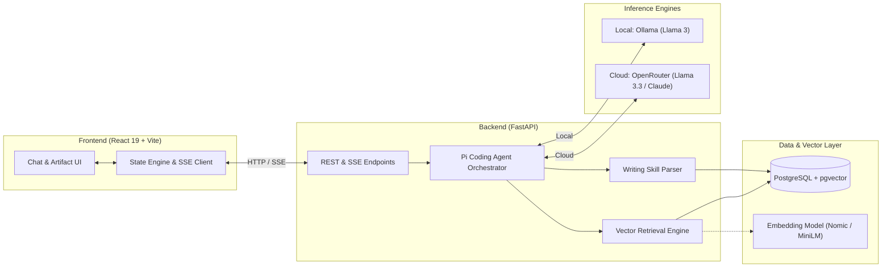

# 🎙️ The Lenny Growth Assistant

[](https://fastapi.tiangolo.com)
[](https://react.dev)
[](https://www.typescriptlang.org)
[](https://tailwindcss.com)
[](https://github.com/pgvector/pgvector)
[](https://ollama.com)
[](https://openrouter.ai)
[](LICENSE)

An intelligent, full-stack AI conversational assistant designed to answer product management, growth, and startup strategy questions. Grounded entirely in insights from **Lenny Rachitsky's Podcast and Newsletter** transcripts, the assistant pairs contextual vector retrieval (RAG) with a specialized writing skill that crafts structured essays, teardowns, and actionable roadmaps rendered side-by-side in an interactive artifact viewer.

---

## 📸 Key Features

- **🧠 Grounded RAG Retrieval:** Every answer is backed by semantically retrieved transcript segments. Interactive source badges link directly to episodes, speakers, and context.
- **⚡ Dual LLM Provider Switching:** Seamlessly switch between **Local (Ollama / Llama 3)** for offline privacy and **Cloud (OpenRouter / Llama 3.3 70B / Claude)** for high-reasoning tasks.
- **📝 Dedicated Writing Skill & Artifacts:** Prompts requesting essays, briefs, or guides activate a specialized writing skill that generates structured `<antArtifact>` documents rendered in a collapsible side pane.
- **🌊 Realtime SSE Streaming:** Token-by-token streaming via Server-Sent Events (SSE) with resilient reconnection, optimistic UI updates, and cancellation controls.
- **💬 Full Conversation Persistence:** Multi-turn conversation management with automatic thread creation, renaming, pagination, and cascade deletion.
- **🎨 Modern Dark-Themed UI:** Built with React 19, Tailwind CSS v4, and Radix UI primitives. Includes a responsive 3-pane layout, markdown formatting, syntax highlighting, and copy/download controls.

---

## 🏛️ System Architecture



---

## 📁 Repository Structure

```
lenny-s-chatbot/
├── backend/                  # FastAPI Application
│   ├── alembic/              # Database migration scripts
│   ├── app/                  # Application core, API routes, models, & services
│   │   ├── api/routes/       # Endpoints: chat, conversations, artifacts, health
│   │   ├── core/             # Configuration & environment settings
│   │   ├── db/               # SQLAlchemy session & base models
│   │   ├── models/           # Conversation, Message, Artifact ORM models
│   │   ├── schemas/          # Pydantic validation schemas
│   │   └── services/         # LLM abstraction, RAG retrieval, vector store, writing skill
│   ├── data/                 # Podcast & newsletter transcript datasets
│   ├── tests/                # 65+ automated Pytest unit and integration tests
│   ├── benchmark.py          # Latency & quality benchmarking harness
│   ├── requirements.txt      # Python dependencies
│   └── README.md             # Backend setup & API reference
│
├── frontend/                 # React 19 + TypeScript Application
│   ├── src/
│   │   ├── components/       # Chat, Sidebar, ArtifactViewer, & UI primitives
│   │   ├── hooks/            # Custom hooks
│   │   ├── routes/           # TanStack file-based routing
│   │   ├── services/         # REST API & SSE streaming clients
│   │   ├── test/             # Vitest unit & integration test suites
│   │   └── styles.css        # Tailwind CSS theme & tokens
│   ├── package.json          # Node dependencies & build scripts
│   └── README.md             # Frontend setup & component guide
│
├── docs/                     # Project Specifications & Audit Reports
│   ├── specs/                # PRD, Architecture, Design, & RAG specs
│   ├── reports/              # Phase audit reports & compliance documentation
│   └── README.md             # Documentation index & guide
│
├── docker-compose.yml        # PostgreSQL with pgvector container
├── .env.example              # Environment variables template
└── README.md                 # Project README
```

---

## 🚀 Quickstart Guide

### Option 1: Full Local Setup (Recommended)

#### 1. Clone the Repository
```bash
git clone https://github.com/Nisxzn/lenny-s-chatbot.git
cd lenny-s-chatbot
```

#### 2. Start PostgreSQL with pgvector
```bash
docker-compose up -d db
```
*(Note: If Docker is unavailable, the backend automatically initializes an in-memory / local SQLite store so you can start right away!)*

#### 3. Setup and Start Backend
```powershell
cd backend
python -m venv venv
.\venv\Scripts\Activate.ps1
pip install -r requirements.txt
cp .env.example .env

# Run database migrations
alembic upgrade head

# Start API server
uvicorn app.main:app --reload --port 8000
```
Backend API will be active at `http://localhost:8000` (docs at `http://localhost:8000/docs`).

#### 4. Setup and Start Frontend
In a new terminal:
```bash
cd frontend
npm install
cp .env.example .env.local
npm run dev
```
Open `http://localhost:5173` in your browser.

---

## ⚙️ Environment Configuration

Copy `.env.example` in root or `backend/.env.example` to `.env`:

| Variable | Default | Purpose |
| :--- | :--- | :--- |
| `DEFAULT_LLM_PROVIDER` | `local` | Default provider (`local` for Ollama, `cloud` for OpenRouter) |
| `OLLAMA_BASE_URL` | `http://localhost:11434` | Base URL for local Ollama server |
| `OLLAMA_MODEL_NAME` | `llama3` | Local model name (auto-detects tool calling) |
| `OPENROUTER_API_KEY` | - | API key for cloud OpenRouter inference |
| `OPENROUTER_MODEL` | `meta-llama/llama-3.3-70b-instruct:free` | Cloud model identifier |
| `DATABASE_URL` | `postgresql+psycopg://...` | PostgreSQL connection string |
| `BACKEND_PORT` | `8000` | Port for FastAPI server |
| `VITE_API_BASE_URL` | `http://localhost:8000/api/v1` | Backend endpoint for frontend client |

---

## 🧪 Testing & Verification

The codebase includes comprehensive automated test suites for both frontend and backend:

### Backend Tests (Pytest)
```powershell
cd backend
pytest -v
```
- **65 tests** covering conversation CRUD, RAG vector retrieval, SSE event streaming, writing skill XML parsing, and Ollama/OpenRouter compatibility.

### Frontend Tests (Vitest & ESLint)
```bash
cd frontend
npm test
npm run lint
```
- Unit and integration tests covering routing, conversation state machine, and streaming chat flows.

---

## 📚 Detailed Documentation

All detailed specifications and audit logs are documented in `/docs`:
- **[Product Requirements Document (PRD)](./docs/specs/PRD.md)**
- **[System Architecture Details](./docs/specs/architecture.md)**
- **[Frontend Design System](./docs/specs/design.md)**
- **[RAG Pipeline Design](./docs/specs/rag.md)**
- **[Writing Skill & Artifacts Specification](./docs/specs/writing-skill.md)**
- **[Agent Framework Compliance Report](./docs/reports/agent-framework-compliance.md)**
- **[Full Documentation Index](./docs/README.md)**

---

## 📄 License

This project is licensed under the [MIT License](LICENSE).
